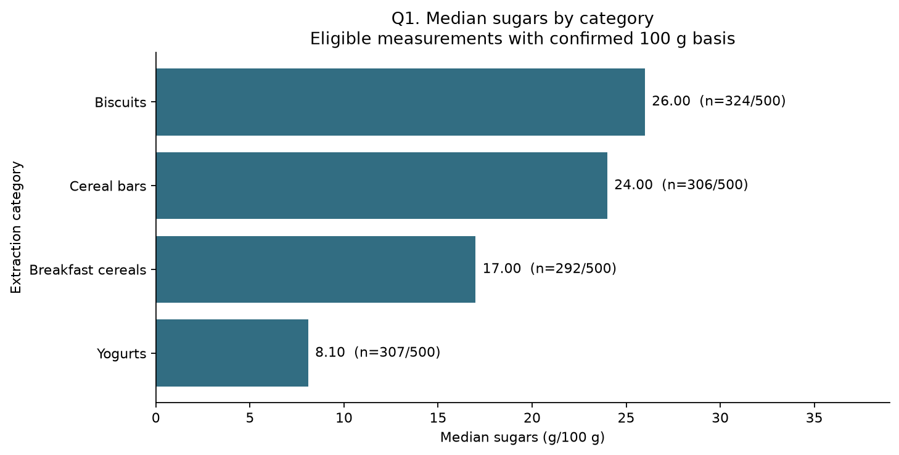
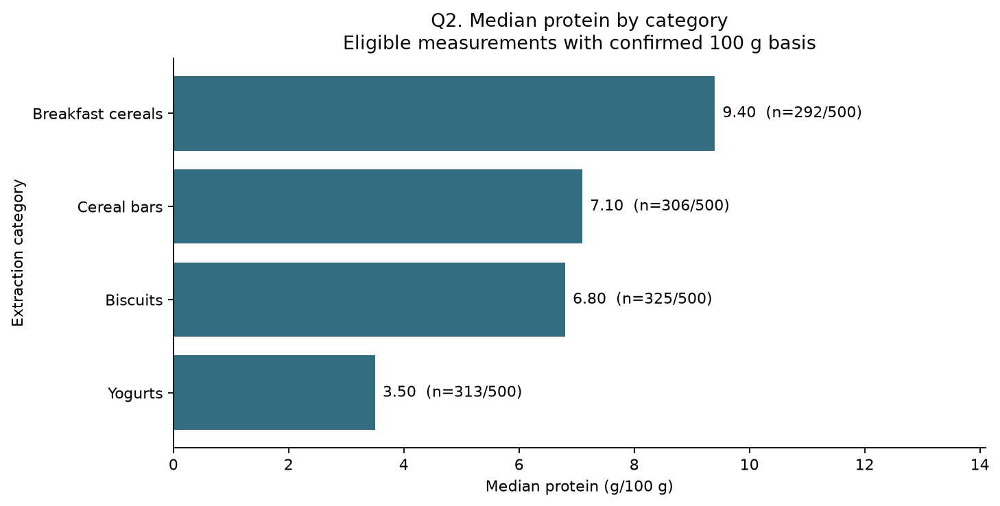
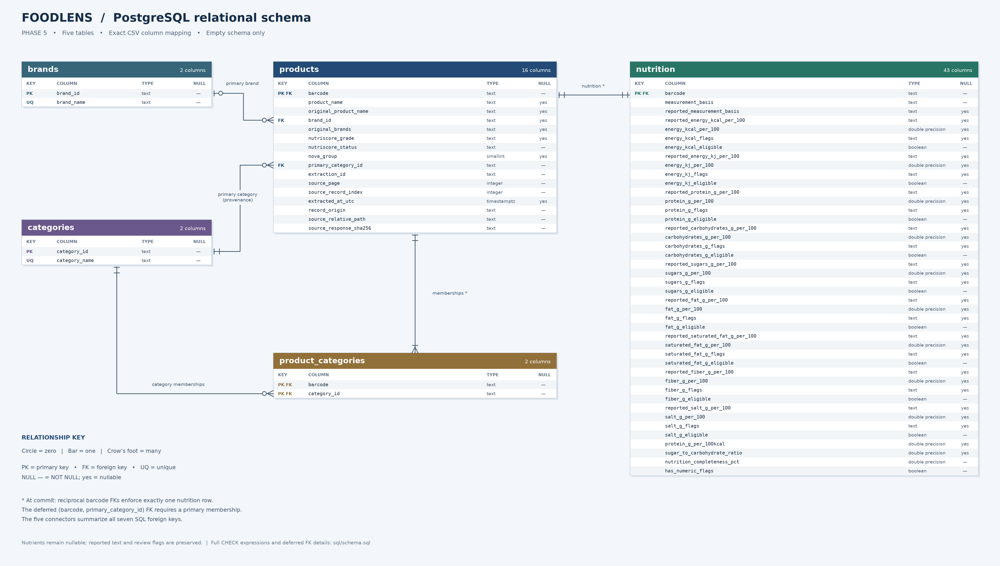

# FoodLens: Food Nutrition Quality & Data Analysis ETL Pipeline

**University data analysis project | Python · Pandas · Matplotlib · PostgreSQL · SQL · Jupyter · Neon**

FoodLens collects real food-product records from [Open Food Facts](https://world.openfoodfacts.org/), investigates their quality, preserves and cleans reported nutrition measurements, and organizes the results in PostgreSQL for reproducible analysis. It is a **data pipeline and analytical project**, not a food recommendation app or web dashboard.

## Project at a glance

| Metric | Result |
| --- | ---: |
| Source records | 2,000 across four categories |
| Unique products | 1,987 (13 cross-category overlaps) |
| Categories | 4: breakfast cereals, yogurts, biscuits, cereal bars |
| Relational tables | 5 |
| Total loaded database rows | 6,503 (including memberships and nutrition rows) |
| Pandas analyses / exported charts | 5 / 5 |
| Read-only SQL reports | 8 |
| Offline automated tests | 89 passed in final submission validation |

**Pipeline:** Open Food Facts API → preserved JSON and combined CSV → exploratory data analysis → Pandas cleaning and five CSV tables → Neon PostgreSQL → SQL reports.

**What matters about data quality:** Missing nutrients stay missing, suspicious values are flagged rather than silently fixed, barcode strings are preserved, overlapping category memberships are retained, and strict per-100-g comparisons require a confirmed measurement basis.

## Selected findings

These describe the project's **nonrandom sample**, not all foods or a universal health ranking. Median per-100-g results use eligible, confirmed mass-basis measurements.

| Analytical question | Finding |
| --- | --- |
| Highest median sugar | Biscuits: **26.00 g/100 g** (324 eligible category products) |
| Highest median protein | Breakfast cereals: **9.40 g/100 g** (292 eligible category products) |
| Highest protein per 100 kcal | Carrefour Sensation Skyr Nature: **19.37 g/100 kcal** |
| Highest reported nutrition completeness | Breakfast cereals: **98.675%** |
| Common Nutri-Score for biscuits | Grade **E**, 268 of 500 category memberships |





### Relational database design



The schema consists of `brands`, `products`, `categories`, `product_categories` and `nutrition`. See [SQL schema](sql/schema.sql), [editable diagram](reports/erd.dbml), and [eight SQL reports](sql/reports.sql).

## Explore and reproduce

- **Read the project report:** [Final academic report](reports/FoodLens_Final_Report.md)
- **View executed notebooks:** [Exploratory analysis](notebooks/01_eda.ipynb) · [Nutritional analysis](notebooks/02_data_analysis.ipynb)
- **View actual database results:** [Eight saved SQL CSV reports](reports/sql_results/) · [SQL validation](reports/phase7_validation.md)
- **Reproduce from the submission package:** [Submission and offline setup guide](SUBMISSION_README.md) · [Validation record](reports/submission_validation.md)

**Important:** Some raw and cleaned datasets are intentionally excluded from Git. A GitHub clone alone does **not** reproduce the entire ETL pipeline. The separately generated `submission/FoodLens_Submission.zip` includes the required source snapshots and cleaned files. Obtain that package from the project owner or the academic submission, then follow `SUBMISSION_README.md`. The offline workflow does not need an Open Food Facts download or a live database; live PostgreSQL reproduction requires a separate database and your own credentials.

If you already have the submission data in place and have installed the documented dependencies in Python 3.12, you can verify the saved results and run offline tests from the repository root:

```powershell
.\.venv\Scripts\python.exe scripts/verify_saved_results.py
.\.venv\Scripts\python.exe -m unittest discover -s tests -v
```

For full setup, notebook execution, extraction history and database-loading safeguards, see [submission instructions](SUBMISSION_README.md) and the detailed phase-by-phase technical reference below.

---

## Technical documentation by phase


University semester project. Phase 1 implements extraction, source preservation,
resumable pagination, and analytical exports. Phase 2 adds a read-only exploratory
notebook. Phase 3B adds an offline five-table cleaning and transformation pipeline.
Phase 4 answers five nutritional analysis questions in an executed notebook.
Phase 5 defines the PostgreSQL schema and a detailed, editable ERD.
Phase 6 implements safe PostgreSQL loading and complete content verification.
Phase 6 is complete: the project owner reports a successful Neon load, full content
verification and an identical rerun, with 6,503 rows across the five tables.
See the Phase 6 validation report for the final live results and evidence history.
Phase 7 implements eight read-only SQL reports extracting insights from the database.

## Final academic submission

All seven technical phases are implemented. See the complete editable
[final report](reports/FoodLens_Final_Report.md),
[submission instructions](SUBMISSION_README.md), and
[final verification record](reports/submission_validation.md).
The submission package is generated separately under `submission/`; it includes
the required saved sources and cleaned datasets that Git ignores. A Git checkout
alone does not contain those inputs. No fresh API download is required.

The final audit corrected Phase 7 narrative figures for Q6-Q8 against the existing
SQL exports. Verify all eight saved results without connecting to a database:

```powershell
.\.venv\Scripts\python.exe scripts/verify_saved_results.py
```

DOCX/PDF export could not be reliably rendered in the available environment;
the full Markdown report includes relative links to all five charts and the ERD.
Complete its cover placeholders and check your institution's submission rules.

## Phase 6: load cleaned data into Neon PostgreSQL

The loader uses Pandas, Psycopg 3 and python-dotenv with the existing
`sql/schema.sql`. It defaults to **read-only verification**. It checks the live
columns, types, nullability, primary/unique/foreign keys, FK timing/actions and
CHECK expressions before any inserts. A schema mismatch stops for manual review;
the loader never creates or alters tables. See [Phase 6 validation](reports/phase6_validation.md).

Run these commands from the repository root. The saved source pages and processed
data must be available locally; no new Open Food Facts extraction is needed:

```powershell
# For a fresh checkout only, create the environment if it does not exist:
# py -3.12 -m venv .venv
.\.venv\Scripts\python.exe -m pip install -r requirements.txt
.\.venv\Scripts\python.exe -m src.clean_transform
.\.venv\Scripts\python.exe -m src.load_postgres --offline
.\.venv\Scripts\python.exe -m unittest discover -s tests -v
.\.venv\Scripts\python.exe -m pip check

# Create a local template only if .env does not already exist:
if (-not (Test-Path .env)) { Copy-Item .env.example .env }
notepad .env
```

Replace the entire placeholder `DATABASE_URL` with the private PostgreSQL URL
from Neon's Connect dialog (database `neondb`). Do not paste credentials into chat,
source code, screenshots or reports. `.env` is ignored by Git. An existing process
environment variable takes precedence over `.env`; dotenv interpolation is disabled
to preserve literal password characters. Missing, incomplete and placeholder URLs
stop before connecting. The loader requires explicit TLS, strengthens
`sslmode=require`/`verify-ca` to `verify-full`, and defaults to the CA bundle from
the already-installed `certifi` package. Explicit `sslrootcert` in the URL takes
precedence over `PGSSLROOTCERT`; either overrides the default. This avoids a
verified Windows/libpq failure with `sslrootcert=system`, without weakening TLS.
Other URL settings, including channel binding and the selected endpoint/database,
are preserved. Failures identify the operation, a safe diagnostic and SQLSTATE
when available, without printing URLs or raw database exceptions. This verifies
the certificate and hostname as described in the
[PostgreSQL TLS documentation](https://www.postgresql.org/docs/17/libpq-ssl.html).

**Schema setup is only for a fresh database.** The existing Neon tables were
already created successfully according to the project owner; skip this step there.
For a fresh Neon database, run the complete `sql/schema.sql` in its SQL Editor.
Alternatively, with PostgreSQL 17+ client tools installed, use placeholders for
your host/role and enter the password at the prompt:

```powershell
$env:PGSSLMODE = 'verify-full'
$env:PGSSLROOTCERT = (& .\.venv\Scripts\python.exe -c "import certifi; print(certifi.where())")
$env:PGCHANNELBINDING = 'require'
psql -X -h YOUR_NEON_HOST -U YOUR_NEON_ROLE -d neondb -W -v ON_ERROR_STOP=1 -f sql/schema.sql
```

Then inspect the configured database safely:

```powershell
.\.venv\Scripts\python.exe -m src.load_postgres --verify-only
```

An `empty` result means all five tables are empty and compatible. After explicitly
approving the live load, execute:

```powershell
.\.venv\Scripts\python.exe -m src.load_postgres --load
.\.venv\Scripts\python.exe -m src.load_postgres --verify-only
.\.venv\Scripts\python.exe -m src.load_postgres --load
```

For a fresh reproduction, the first load should report `loaded`; both following commands should report
`identical`, with 525 brands, 4 categories, 1,987 products, 2,000 memberships and
1,987 nutrition rows (6,503 total). This sequence has already succeeded in the
existing Neon database, as reported by the project owner; no reload is needed.
`--load` is the explicit insert opt-in. Offline tests always
mock connections, even when `DATABASE_URL` is set; the commands above are the
intentional live integration checks. Exit code 0 indicates success (including a
compatible empty database during verification); exit code 1 indicates a safe stop.

The insert order is brands, categories, products, product_categories, nutrition.
All inserts and their validation share one transaction; failures roll it back.
After read-only preflight, a short table lock serializes writers and the loader
rechecks schema/content before inserting. Timeouts stop safely if locks or queries
cannot finish. No rows are deleted, replaced or updated. A populated database is
accepted only when **every cell in every row** matches the cleaned CSVs, regardless
of row order. Same-count changed data and partial loads stop for manual review.
Comparisons preserve exact text, binary64 numeric values, timestamp instants and
SQL NULL, and explicitly query counts, duplicate keys, all seven FKs, 83 leading-zero
barcodes and 13 overlapping products. Every missing nutrient and category pair is
also covered by the complete comparison. Identical reruns perform no inserts.

No cleaned CSV is rewritten by the loader. The existing transformer validates and
reuses identical outputs. Keep all five CSVs fixed during a load. If a connection
fails around commit, the outcome can be uncertain; rerun read-only verification
to determine whether the complete transaction committed. Never clear tables to retry.

## Phase 7: SQL reporting and insights

The final technical phase executes eight SQL reports against the populated Neon database.
It runs a single read-only, repeatable-read transaction to ensure no data is modified.

Run the reports from the repository root:

```powershell
.\.venv\Scripts\python.exe scripts/run_sql_reports.py
```

This connects using the same `DATABASE_URL` in `.env` and exports the results to `reports/sql_results/`.
The SQL file `sql/reports.sql` contains the queries demonstrating JOINs, aggregations, conditional counting (CASE WHEN), HAVING clauses, and PostgreSQL's PERCENTILE_CONT.
See [Phase 7 validation](reports/phase7_validation.md) for the execution results and a comparison to the Phase 4 insights.

## Phase 5: PostgreSQL schema and ERD

The five tables map directly to all 65 columns in the cleaned CSVs: `brands`,
`products`, `categories`, `product_categories`, and `nutrition`. See
[the schema](sql/schema.sql), [the ERD](reports/erd.png),
[editable DBML](reports/erd.dbml), and [validation report](reports/phase5_validation.md).
Barcodes remain text, missing measurements remain nullable, and reported nutrient
strings and review flags are retained. No product records are loaded in Phase 5.

With PostgreSQL installed and its command-line tools available, run from the
repository root using an account allowed to create databases and tables:

```powershell
createdb -U postgres foodlens
psql -X -U postgres -d foodlens -v ON_ERROR_STOP=1 -f sql/schema.sql
```

Use your configured PostgreSQL role in place of `postgres`; let the client prompt
for a password if required. The database must be fresh. The schema runs in one
transaction and intentionally fails if tables already exist, rather than hiding
schema differences. It creates five empty tables and supporting indexes in `public`.
It contains no record-loading commands. PostgreSQL was unavailable during the
historical Phase 5 validation. The project owner subsequently executed this schema
in Neon; independent live verification is tracked in the Phase 6 report.

The product-to-nutrition relationship is exactly one-to-one at commit, enforced
by reciprocal barcode FKs. A composite FK also requires each product's primary
category to exist among its memberships. These two product-side FKs are deferred:
the Phase 6 loader inserts products, memberships and nutrition within one transaction.

Reproduce the ERD and run offline validation with the existing environment:

```powershell
.\.venv\Scripts\python.exe scripts/generate_erd.py
.\.venv\Scripts\python.exe scripts/validate_phase5.py
.\.venv\Scripts\python.exe -m unittest discover -s tests -v
git diff --check
```

The renderer reads the SQL and writes DBML plus a high-resolution PNG using the
existing Matplotlib dependency. SQL is authoritative; edit it and regenerate both
ERD files. The offline validator checks CSV mappings, types, keys, nullability and
translated scalar CHECK expressions; it does not substitute for PostgreSQL DDL
execution. DBML records deferred-FK semantics in notes because DBML cannot express
transaction timing. No external diagram service or API is used.

## Phase 4: data analysis and insights

Run the analysis from the repository root with the existing notebook dependencies:

```powershell
.\.venv\Scripts\python.exe scripts/execute_analysis.py
```

This executes `notebooks/02_data_analysis.ipynb` using fresh kernels with the
project interpreter, once from the repository root and once from `notebooks/`.
It saves the executed notebook after both runs pass and exports five PNG charts
to `reports/figures/phase4_*.png`. It checks all cells, five embedded figures,
identical exported chart hashes across runs, and preservation of every data file
and the Phase 2 notebook. No global kernel registration or `PYTHONPATH` workaround
is needed. For interactive execution, select the `.venv` kernel and run all cells
from either supported working directory. If setting up a new environment, the
existing `requirements-eda.txt` contains the required notebook/plotting tools.

The notebook reads all five cleaned CSVs without regenerating them. Its questions
cover category median sugars and protein, the top ten protein-per-100-kcal ratios,
reported nutritional completeness, and Nutri-Score distributions. Per-100-g
comparisons require confirmed mass basis and the relevant eligibility flag.
Ratios require eligible operands, positive kcal and a known common mass or volume
basis. Overall rankings use unique products; category summaries use all memberships.
Completeness and grade distributions include all 500 memberships per category.
Unknown and not-applicable Nutri-Score states stay separate and in the denominator.

See `reports/phase4_validation.md` for the five numerical answers, sample sizes,
limitations and actual execution/test results. These are descriptive results for
the saved nonrandom sample, not health rankings or market-wide estimates.

## Phase 3B: cleaning and transformation

From the repository root, using the existing virtual environment:

```powershell
.\.venv\Scripts\python.exe -m src.clean_transform
.\.venv\Scripts\python.exe -m unittest discover -s tests -v
.\.venv\Scripts\python.exe -m pip check
```

The transformer reads the combined CSV and preserved source pages, verifies their
checksums and memberships, and creates `brands.csv`, `products.csv`,
`categories.csv`, `product_categories.csv`, and `nutrition.csv` in `data/cleaned/`.
No API access or new dependencies are needed. The outputs contain 525 primary
brand labels, 1,987 products, four categories, 2,000 membership links, and 1,987
nutrition rows. The simplified five-table design follows the Phase 3B request
and supersedes the six-table proposal in `reports/phase3_cleaning_plan.md`.

Names and brands receive NFC/whitespace normalization without case/fuzzy merging.
The first nonempty comma-separated brand is the primary brand; full original
names and brand strings remain in `products`. Barcodes stay exact strings.
All category overlaps remain. Only the four extraction categories become entities;
flattened source taxonomy strings are not split into new relationships.

Nutrition uses neutral **per-100** names because saved source records confirm
1,254 mass-basis products, five volume-basis products and 728 with unknown basis:

- `reported_<nutrient>_per_100` preserves each original CSV observation as text.
- `<nutrient>_per_100` is nullable numeric. Five individually implausible values
  become null; original missing values remain missing.
- `<nutrient>_flags` records numeric reasons separately from missingness.
- `<nutrient>_eligible` requires a present numeric value with no numeric flag.
  Unresolved cross-field values remain stored, but both implicated operands are
  ineligible for strict analyses and derived ratios. No source is guessed correct.
- `measurement_basis` is `100g`, `100ml` or `unknown`. For a strict per-100-g
  comparison, filter **both** `measurement_basis == '100g'` and the relevant
  nutrient's eligibility. For multiple nutrients, require every operand eligible.

Reload with the provided helper to restore nullable dtypes and leading zeros:

```python
from src.clean_transform import reload_tables

tables = reload_tables("data/cleaned")
nutrition = tables["nutrition"]
strict_energy = nutrition.loc[
    nutrition["measurement_basis"].eq("100g") & nutrition["energy_kcal_eligible"],
    ["barcode", "energy_kcal_per_100"],
]
```

When reading CSVs directly, use `dtype="string", keep_default_na=False,
na_values=[""]` first, then explicitly convert intended numeric/Boolean columns.
CSV blanks represent nulls, not zeros. Do not rely on spreadsheet barcode inference.
Protein per 100 kcal and sugar/carbohydrate ratios require eligible operands,
positive denominators and a known common basis. Completeness counts reported
values in eight fields (kcal plus seven gram nutrients), excluding duplicate kJ
energy coverage. It is not a food health score.

Identical reruns verify and reuse existing output files without rewriting them.
Differing existing outputs cause a safe stop; the command never silently replaces
them. CSV writes are atomic per file, not across all five. After an interrupted
first run, rerun the command to finish missing files and validate the complete set.
Wait for the successful validation message before using outputs. Existing raw,
processed, checkpoint, backup and notebook files remain unchanged.

See `reports/phase3_validation.md` for schemas, precise thresholds, measured
missingness, exclusions, source limitations and executed validation results.

## Phase 2: exploratory data analysis

Open `notebooks/01_eda.ipynb` using the project's `.venv` Python kernel. It reads
`data/processed/food_products_analysis_combined_725f8a023f0f8ee6.csv` and checks its
metadata, saved pages, and category checkpoints. Keep the complete Phase 1 data
directory available locally; source data are intentionally excluded from Git.
The notebook runs with its working directory at either the repository root or
`notebooks/`. No absolute machine paths or live API access are required.

Install the additional plotting/execution tools, then execute and validate from
the project root:

```powershell
.\.venv\Scripts\python.exe -m pip install -r requirements-eda.txt
.\.venv\Scripts\python.exe scripts/execute_eda.py
```

The executor starts a fresh kernel with the same `.venv` interpreter in each
working directory. It checks all cells, seven embedded figures, and the hashes,
sizes and modification times of all existing data files. It writes the executed
notebook only after both runs pass. It does not need JupyterLab, Notebook Server
or a globally registered kernel. In an interactive editor, explicitly select
the `.venv` interpreter. Kernel startup may emit local IPython/Jupyter permission
or transport warnings under a restricted Windows account; notebook errors still
fail execution.

The notebook covers the verified 2,000 source records / 1,987 unique products,
24 fields, missingness, identities, category overlaps, brand strings, Nutri-Score,
NOVA, nutrition summaries, internal consistency and category-specific IQR flags.
Category comparisons use **all memberships**, with shared products counted once
per category. Overall summaries use unique products. Seven figures include
calculated interpretations. All numeric conversions and filtering are temporary
EDA views; no cleaning, imputation or outlier removal is saved.

See `reports/phase2_validation.md` for measured findings and execution evidence.

## Current saved data

The breakfast-cereals extraction contains **500 unique products** in its
independent checkpoint `255549a7a8a480c0`. Its raw page snapshots, manifest,
checkpoint, and analytical export are retained unchanged. Additional categories
use different configuration-derived extraction IDs and never reuse this
checkpoint.

Before editing the script, the original script and both datasets were copied to
`data/backups/pre_extraction_upgrade_20261009T040156Z/`. Its `manifest.json`
records byte sizes and SHA-256 hashes. Legacy import also creates a
content-addressed backup under `data/backups/legacy_<hash>/`.

## Resume downloading

Run from the project root in PowerShell. A real contact email is required
for live requests; it is used in the User-Agent and saved extraction metadata.

The `.venv` uses Python 3.12.4, the Phase 1 and Phase 6 dependencies from
`requirements.txt`, plus the optional Phase 2 tools in `requirements-eda.txt`.
Activate it normally; no `PYTHONPATH` workaround is needed:

```powershell
Set-Location <path-to-foodlens-etl>
Set-ExecutionPolicy -Scope Process -ExecutionPolicy RemoteSigned
.\.venv\Scripts\Activate.ps1
$env:FOODLENS_CONTACT_EMAIL = Read-Host 'Enter your contact email'
python src/download_dataset.py --target 500
```

If your shell still has the earlier workaround set, clear it once with
`Remove-Item Env:PYTHONPATH -ErrorAction SilentlyContinue` before activation.
The execution-policy command is needed when PowerShell blocks activation scripts;
it applies only to the current shell and does not change the user or machine policy.
You can also run `.\.venv\Scripts\python.exe` directly without activating.
The extraction script itself only needs `requests`; pandas and NumPy are also
installed for later project phases. Phase 6 adds the PostgreSQL loading dependencies.

The same command resumes automatically. It will not request completed pages.
The target is a stopping threshold: the last successful page is retained in
full, so the analytical CSV can contain slightly more than 500 unique products.
Changing the target, contact email, or retry policy reuses saved pages. Changing
the category, page size, requested fields, or source URL selects a separate
extraction ID and separate output files.

To rebuild the analytical CSV and checkpoint without contacting the API:

```powershell
python src/download_dataset.py --offline
```

For a fresh copy of this project with the original data but no saved page files,
use `--import-legacy --offline` once. This option only accepts the known
100-record page 1 with the original breakfast-cereals filter and page size 100;
it is not a general importer for arbitrary JSON files. Repeating it after import
does not add records again. The original extraction timestamp and full response
envelope were never saved, so imported rows have a blank extraction timestamp
and an explicit `legacy_import` origin. The import time is recorded separately.

## Multi-category extraction

The verified Open Food Facts taxonomy identifiers are:

| Category | Identifier | Target |
| --- | --- | ---: |
| Breakfast cereals | `breakfast-cereals` | 500 |
| Yogurts | `yogurts` | 500 |
| Biscuits | `biscuits` | 500 |
| Cereal bars | `cereal-bars` | 500 |

The category identifier is part of the extraction configuration and checkpoint
identity. The completed breakfast-cereals checkpoint is reused and does not
trigger another request. Download only the additional categories:

```powershell
python src/download_dataset.py --category yogurts --target 500
python src/download_dataset.py --category biscuits --target 500
python src/download_dataset.py --category cereal-bars --target 500
```

Each command writes independent raw page snapshots, manifests, checkpoints, and
per-category analytical CSV output. Use the same command again to resume an
interrupted category; completed categories are not downloaded again.

After all four category checkpoints are complete, combine them without network
access:

```powershell
python src/download_dataset.py --combine-categories breakfast-cereals,yogurts,biscuits,cereal-bars
```

The combined output has 24 columns, including the analytical nutrient fields,
the original `categories` taxonomy tags, the extraction category,
`extraction_categories`, and `category_membership_count`. Products are globally
deduplicated by exact barcode; the first category's row supplies the retained
product/nutrient values and all category memberships are merged. The adjacent
JSON metadata file reports raw records, per-category unique products, missing
barcodes, duplicate/invalid barcode issues, and overlapping products. The
combiner only reads saved checkpoints/pages and never makes API requests.

## Request behavior

- Source: `https://world.openfoodfacts.org/api/v2/search`.
- Category filter: `categories_tags_en=<category>`; page size 100; original
  requested fields preserved. No explicit sort is used, so the API's default
  order is retained.
- Target: 500 unique usable barcodes. Default budget: 20 completed pages in total,
  including earlier runs. This prevents endlessly fetching duplicate-only pages.
- User-Agent: `FoodLensStudentProject/2.0 (your-contact-email)`.
- At least 10 seconds between request starts, including retries. Cooldowns are
  persisted across local runs and configurations sharing the data directory.
- HTTP 429, 500, 502, 503, and 504, plus connection errors/timeouts, get at most
  three retries after the first attempt. Exponential backoff starts at 10 seconds
  and caps at 120 seconds. HTTP `Retry-After` supports seconds and HTTP dates;
  the largest applicable delay wins, including on the final failed attempt.
- If a cooldown exceeds the default 300-second waiting budget, extraction stops
  incomplete and retains the deadline for a later resume. It never shortens a
  server-requested cooldown. Connection timeout is 10 seconds and read timeout
  is 45 seconds. Read timeout is not a strict whole-response deadline.
- Non-retryable HTTP errors, malformed JSON, and invalid page structures stop
  safely. Redirects are disabled to avoid uncounted additional requests.
- An empty/short page or reported total count reaching the last page marks the
  source exhausted. Below the target, the extraction remains incomplete.
- Exit codes: `0` for completed extraction or successful offline rebuilding,
  `2` for a live extraction that stops incomplete (also argparse usage errors),
  and `1` for local storage/configuration failures. Ctrl+C during downloading
  records the interrupted state and retains saved pages.

Use `python src/download_dataset.py --help` for configurable limits.

Open Food Facts currently documents **10 search requests/minute/IP** and asks
clients to identify themselves with a custom User-Agent. It recommends bulk
exports for larger extractions beyond a few hundred products. This small,
bounded semester-project extraction retains the requested API workflow; use
bulk exports if the project expands. Other clients on the same IP can consume
the same rate limit. See the [official API guidance](https://github.com/openfoodfacts/openfoodfacts-server/blob/main/docs/api/index.md)
and [search endpoint documentation](https://openfoodfacts.github.io/documentation/docs/Product-Opener/v2/search/get-search/).

## Saved artifacts and recovery

```text
data/
  backups/                                  Original files and checksum manifests
  raw/
    food_products_raw.json                  Original 100 records; never overwritten
    food_products_extracted.csv             Original wide CSV; never overwritten
    extractions/<extraction_id>/
      manifest.json                         Configuration and extraction creation time
      pages/page_000001.json                Immutable page with response + metadata
      checkpoint.json                       Completed pages, progress, counts, policy
      barcode_issues.json                   Exclusions with page/record references
  processed/
    food_products_analysis_<id>.csv          Separate, deduplicated 21-column export
  request_cooldown.json                      Created when a live request is attempted
  .extraction.lock                          Persistent file; OS releases its lock on exit
```

Each successful API response is preserved in full as parsed JSON under the page's
`response` key, including duplicate records and unused nutrients. JSON whitespace
and object key order are normalized; this is not a byte-for-byte HTTP capture.
Page metadata includes the requested URL/parameters, UTC extraction and save
timestamps, row count, response checksum, successful attempt count, HTTP status,
server Date header, User-Agent, and request policy.

The page file is the durable commit point. The CSV and barcode audit file are
rebuilt next; the checkpoint is published last. All writes use a temporary file
in the destination directory, flush + `fsync`, and `os.replace`. A process crash
between page and checkpoint writes is recovered by scanning and validating saved
pages, without requesting them again. A malformed checkpoint is preserved in a
`checkpoint.corrupt-<hash>.json` file and rebuilt from valid pages. Missing or
damaged raw pages stop recovery instead of being silently replaced or discarded.

The checkpoint includes the CSV hash, response hashes, completed pages, next
page, query parameters, target, actual row counts, status, and stop reason.
If an export/write fails, the checkpoint may lag; fix the filesystem issue and
run `--offline` to rebuild it. Writes are atomic per file, not across all files;
only use the exported CSV when its hash matches the published checkpoint. Local
disk failure or power loss can still require restoration from backups. Do not
edit raw pages or remove checkpoints to force a refresh.

An OS file lock prevents concurrent writers using the same data directory. It
is released on normal exit or process death, so a leftover lock file is harmless.
Separate data directories or machines do not share that lock or cooldown.

## Analytical CSV and barcode policy

The 21 columns are:

| Fields | Meaning |
| --- | --- |
| `barcode`, `product_name`, `brands`, `categories` | Product identity; category tags separated by semicolons |
| `energy_kcal_100g`, `energy_kj_100g` | Reported API energy values; verify source mass/volume basis |
| `protein_g_100g`, `carbohydrates_g_100g`, `sugars_g_100g` | Reported API macronutrient values; verify source mass/volume basis |
| `fat_g_100g`, `saturated_fat_g_100g`, `fiber_g_100g`, `salt_g_100g` | Reported API nutrient values; verify source mass/volume basis |
| `nutriscore_grade`, `nova_group` | Valid grades a-e and NOVA groups 1-4 |
| `source_page`, `source_record_index`, `extracted_at_utc` | Traceability; record index is zero-based |
| `source_url`, `record_origin`, `extraction_id` | Request URL, API/legacy origin, configuration ID |

Only explicit API `_100g` nutrient values are exported. No missing values are
filled, no serving conversions are inferred, and missing/negative/non-finite
nutrient values become blank cells. Zero remains zero. Phase 3B recovered explicit
100 ml and unknown bases in this sample; the historical `_100g` column suffix
alone does not verify a mass basis. Existing exports and EDA outputs remain
unchanged; use the cleaned basis/eligibility fields for strict comparisons.

Usable barcodes are exact ASCII digit strings of length 8-14. Leading zeroes
are preserved. Blank/missing codes and malformed/non-string codes are excluded
from the analytical CSV and listed in `barcode_issues.json`; their source records
remain intact in raw pages. First occurrence in page/record order wins for a
duplicate barcode. Duplicate versions remain available for auditing. There is
no zero-padding, UPC/EAN equivalence conversion, or GTIN checksum validation;
this avoids guessing identifiers and accommodates OFF internal numeric codes.
When importing CSV into pandas or spreadsheets, explicitly treat `barcode` as
text to prevent loss of leading zeroes. Product text is retained as source text.

## Offline verification

From the project root, with the same Python environment:

```powershell
Set-ExecutionPolicy -Scope Process -ExecutionPolicy RemoteSigned
.\.venv\Scripts\Activate.ps1
python -m pip check
python -m unittest discover -s tests -v
python src/download_dataset.py --help
```

The tests use the existing real dataset as fixture input and temporary directories
for all generated test artifacts. HTTP responses and clocks are mocked; accidental
real `requests` HTTP calls raise an error. Deliberately malformed identifiers are
confined to test cases and never enter the project dataset. No extra test package
is needed beyond Python's `unittest` and the downloader's `requests` dependency.

The executed extraction suite has **36 passing tests**, covering category combination,
completion checks, retryable status codes,
exponential backoff, both Retry-After formats, persisted cooldowns, network errors,
checkpoint recovery, missing/corrupt pages, legacy preservation, deduplication,
invalid barcodes, CSV fields, atomic write failures, source exhaustion, page
budgets, interruption, and concurrent-writer exclusion.

## Reproducibility limits

Saved pages and their exact query/response provenance make the local analytical
export reproducible. Open Food Facts is a changing public database: requesting
the same query later need not return the same ordering or products. Pagination
across different times can have overlaps or omissions; deduplication removes
overlaps but cannot recover unseen products. Historical page-1 extraction time
and HTTP response metadata cannot be reconstructed. Reaching 500 depends on API
availability, matching source records, usable barcodes, and request limits.
