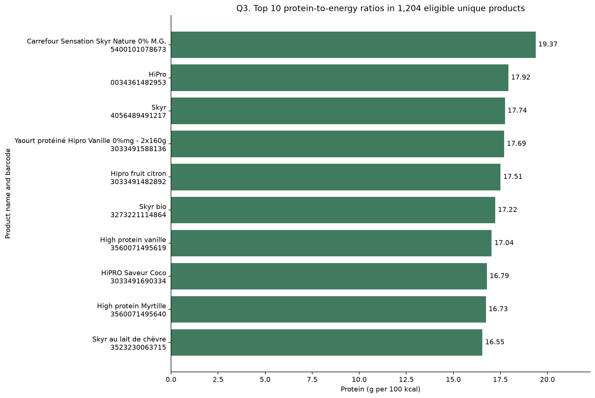
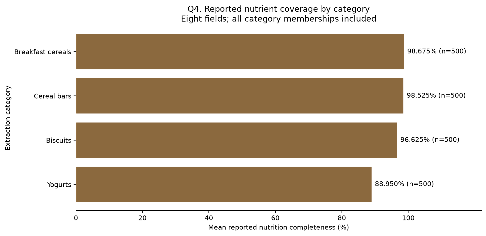
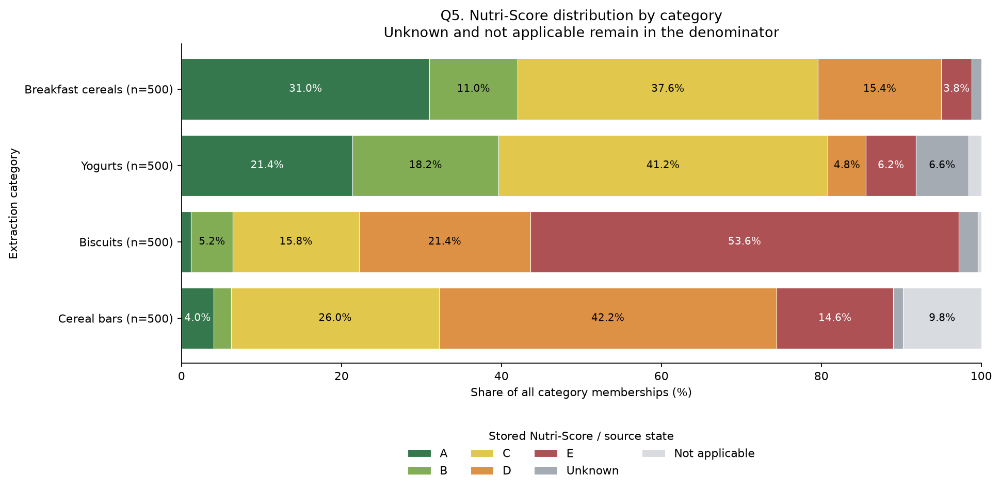

# FoodLens Final Academic Report

**End to End Food Nutrition ETL and Data Analysis Pipeline**

University semester project for a BSCS programme

Student name: **Krish Maharjan**  
Student ID: **WU0240442**  
University and department: **Kings College (BSCS)**  
Course: **Data Analysis with Python**  
Instructor or supervisor: **Anudit Pokhrel**  
Report prepared: **10 October 2026**

## 1 Project overview

FoodLens implements a complete Extract, Transform and Load (ETL) workflow using a saved sample of Open Food Facts product data. The project preserves its sources, investigates data quality, prepares five related tables, analyses nutrition with Pandas, loads the tables into Neon PostgreSQL, and presents eight SQL reports. Its main contribution is a reproducible path from imperfect product observations to qualified analytical findings.

The four extraction categories each contain 500 records. Their combined 2,000 records represent 1,987 unique products because 13 products occur in two categories. FoodLens retains every category membership while storing each product once. It distinguishes missing measurements from reported zeros, preserves suspicious original values, and separates confirmed 100 g, confirmed 100 ml and unknown measurement bases.

Among eligible products with an explicit 100 g basis, biscuits have the highest median sugar concentration at 26.00 g/100 g and breakfast cereals have the highest median protein concentration at 9.40 g/100 g. These are findings about the preserved sample, not estimates for the food market. All eight saved SQL result sets agree with the offline Pandas verification performed for this submission. The current offline suite passes 89 tests. Historical live database evidence is attributed separately; this final preparation did not access the live API or database.

## 2 Introduction

Public food databases make nutritional information available in a form suitable for data analysis. However, collecting records is only the beginning of a useful analytical workflow. Identifiers, categories, units, missing fields and inconsistent measurements must be understood before calculations can be interpreted responsibly.

FoodLens applies the database and Python skills of a university semester project to this problem. Extraction records what was received; EDA examines its structure; transformation creates consistent analytical tables; relational design preserves identities and relationships; and SQL provides another way to answer the same questions. The project therefore demonstrates both data engineering and descriptive analysis.

The report follows the seven implemented technical phases. The original scripts, executed notebooks, validation reports, schema and saved results provide the evidence. Earlier phase reports describe the state at their respective completion dates. Later phases supersede their historical statements that loading or SQL reporting had not yet started.

## 3 Problem statement and objectives

The practical problem is to convert overlapping, incomplete food-product records into a traceable relational dataset without concealing uncertainty. Treating every row as a different product would double-count overlaps. Treating blank nutrition as zero would distort summaries. Assuming that every historical `_100g` field proves a mass denominator would mix unsupported measurements into comparisons.

The project objectives are to:

1. Preserve a sufficiently large real-world source sample and its extraction provenance.
2. Examine data structure, missingness, duplicates, classifications, distributions and suspicious values.
3. Apply documented cleaning rules while retaining original observations and identifiers.
4. Answer five nutritional analysis questions with stated denominators and visual evidence.
5. Model the data in related PostgreSQL tables with keys, constraints and an ERD.
6. Load and verify the tables safely through a repeatable Python workflow.
7. Produce eight meaningful SQL reports and compare their results with the saved analytical data.
8. Supply an offline reproducible submission containing the necessary snapshots, code and evidence.

No prediction model, dashboard, new extraction or additional development phase is required for these objectives.

## 4 Dataset source and description

The dataset comes from preserved Open Food Facts API responses. The endpoint recorded in the implementation is `https://world.openfoodfacts.org/api/v2/search`. Each extraction uses the `categories_tags_en` filter and a page size of 100, with no explicit sort. Five pages were retained for each of breakfast cereals, yogurts, biscuits and cereal bars. The project uses the saved observations rather than attempting to recreate them from a changing service. [R1, R2]

| Category | Extraction ID | Saved pages | Records |
| --- | --- | ---: | ---: |
| Breakfast cereals | `255549a7a8a480c0` | 5 | 500 |
| Yogurts | `a7cac53fa4872087` | 5 | 500 |
| Biscuits | `34e0ad749f6a0fa6` | 5 | 500 |
| Cereal bars | `ed4f16ea3c02f6ab` | 5 | 500 |

The combined analytical CSV has 1,987 rows and 24 columns. Fields cover barcode, product name, brand strings, category tags, nine nutrient measurements, Nutri-Score, NOVA, and source provenance. The nine nutrient measurements are energy in kcal and kJ, protein, carbohydrates, sugars, fat, saturated fat, fiber and salt. The two energy fields describe the same kind of quantity in different units.

The 2,000 records are source occurrences, not 2,000 distinct products. Seven overlaps link breakfast cereals and cereal bars; two link breakfast cereals and biscuits; two link breakfast cereals and yogurts; and two link biscuits and cereal bars. The combined row keeps the first observation according to the configured category order, while a membership field retains all categories. Consequently, overall statistics use 1,987 products and category summaries use 2,000 membership pairs.

The first 100 breakfast-cereal records were imported from a legacy source. Their original extraction timestamps and HTTP metadata are unavailable. They are explicitly labelled as legacy imports, with missing original timestamps; import time is not substituted. The remaining source provenance is retained in page envelopes and checkpoints. No extraction date is inferred for the legacy records.

This is a nonrandom sample with fixed category targets. Equal category counts reflect collection design and say nothing about market share, purchasing patterns or relative category prevalence.

## 5 Technologies and tools

| Tool | Role in FoodLens |
| --- | --- |
| Python 3.12 | Extraction, transformation, validation and database orchestration |
| Requests | HTTP requests, timeout and retry handling during extraction |
| Pandas and NumPy | Typed tables, joins, quality checks, aggregations and derived metrics |
| Jupyter notebooks | Executed EDA and five-question analysis with embedded outputs |
| Matplotlib | Seven EDA figures and five exported analytical charts |
| PostgreSQL on Neon | Relational storage and eight SQL reports |
| Psycopg 3 | Bound SQL parameters, transactions and database verification |
| python-dotenv and certifi | Local configuration and verified TLS certificate support |
| unittest | Offline regression tests using mocks and temporary directories |
| Git | Source version control; large local datasets are separately packaged |

The environment records Python 3.12.4, Pandas 3.0.6, NumPy 2.5.3 and Matplotlib 3.11.2. Exact direct dependency pins are supplied in `requirements.txt` and `requirements-eda.txt`; the latter includes the former. These files are preserved rather than replaced with a new environment specification. A dependency consistency check passed in the existing environment. A fresh dependency installation was not performed during final preparation.

## 6 Data extraction methodology

`src/download_dataset.py` separates extraction configurations so each category has its own saved pages and checkpoint. Requests are bounded by target and page budgets. The implemented policy spaces request starts by at least ten seconds, retries selected server responses and connection failures, honours `Retry-After`, and uses exponential backoff. These are implementation settings, not a claim about the service's current policy. [R1]

Each successful page is preserved before analytical exports and checkpoints are published. JSON files retain the response envelope and metadata such as page number, request configuration and response checksum. The response JSON is normalized for storage and hashing; it is not a byte-for-byte HTTP capture. Atomic replacement protects individual files. A lock prevents concurrent writers to the same data directory, and recovery validates saved pages before rebuilding state.

Barcodes are exact ASCII digit strings of length 8 to 14. This policy preserves leading zeros; it does not pad identifiers or assert GTIN checksum validity. Within an extraction the first valid occurrence is retained for analysis, while duplicates would remain in raw pages. This sample has no rejected missing or invalid barcodes and no within-category duplicates. The combination step merges categories offline and retains all overlapping memberships.

Raw source observations, per-category exports, the combined CSV and their metadata are preserved. The submission includes the files used by existing notebook assertions and regression tests. Backups, extraction locks and cooldown state are excluded because they are unnecessary for reproducing the saved analysis. Extraction is not rerun for submission.

## 7 Exploratory Data Analysis

`notebooks/01_eda.ipynb` examines shape, types, samples, missingness, uniqueness, category membership, brand strings, classifications, nutrient distributions and quality concerns. It contains 19 executed code cells and seven embedded figures, with no saved error outputs. The EDA checks the combined CSV checksum against metadata and reconciles category checkpoints and page response hashes. [R3]

Missingness is measured before transformation. Fiber has the largest nutritional gap: 351 of 1,987 products, or 17.66%. Among 500 yogurt memberships, 273 lack fiber, or 54.6%. The sample also has 40 missing product names, 32 missing brand strings, 116 absent Nutri-Score grades and 130 missing NOVA classifications. These gaps are retained rather than replaced with guessed values.

| Nutrient | Missing source cells | Null cleaned numeric cells |
| --- | ---: | ---: |
| Energy kcal | 39 | 42 |
| Energy kJ | 55 | 55 |
| Protein | 43 | 43 |
| Carbohydrates | 44 | 45 |
| Sugars | 50 | 50 |
| Fat | 41 | 41 |
| Saturated fat | 54 | 54 |
| Fiber | 351 | 351 |
| Salt | 66 | 67 |
| Total | 743 | 748 |

EDA identifies 91 unique products with at least one rule-based nutrition concern. Examples include a salt observation of 295, carbohydrates of 120 and three excessive kcal observations. Energy disagreement is the most frequent review rule, affecting 83 products. The project does not infer a decimal correction or decide which paired energy value is correct.

Category-specific 1.5-times-IQR screening identifies 500 unique products as statistically unusual in at least one nutrient/category combination. Of these, 438 have no rule-based numeric concern. This distinction prevents unusual but plausible products from being deleted merely because they are far from a category's typical value.

The EDA notebook's historical nutrient charts use the original `_100g` export labels. Phase 3 subsequently recovered explicit source denominators. Therefore those exploratory charts are not treated as confirmed mass-basis comparisons. The final nutrient comparisons use the stricter basis and eligibility rules below. All seven original EDA figures remain embedded in the submitted notebook.

## 8 Data cleaning and transformation

`src/clean_transform.py` reads saved files without API access. It verifies source checksums, barcode pointers, nutrient correspondence and category memberships before producing five CSV tables. It preserves all 1,987 products. Existing identical outputs are validated and reused; differing outputs cause a safe stop. [R4]

### 8.1 Identity text and provenance

Barcodes remain text throughout; all 83 codes beginning with zero survive. Names and primary brand tokens receive Unicode NFC and whitespace normalization, without case folding or fuzzy merging. Ten product names change representation. The first nonempty comma-separated brand becomes the primary brand, producing 525 exact labels across 1,955 branded products; 32 products have no primary brand. Original names and full brand strings remain stored. This simplified relationship does not establish corporate ownership.

Known timestamps become UTC datetimes. The 100 unknown legacy timestamps stay missing. Products retain extraction ID, page, zero-based record index, source-relative path and canonical response checksum. Only the four extraction categories become category entities; flattened source taxonomy strings are not split into invented relationships.

### 8.2 Missing values and quality flags

Every nutrient has an original reported string, a nullable numeric value, reason flags and an eligibility Boolean. A blank means missing information; a reported zero remains zero. Reading CSVs with explicit string types, `keep_default_na=False` and `na_values=['']` preserves identifiers and literal text labels before deliberate conversion. These options are documented in Pandas. [R9]

Individual invalid values can become null in the analytical numeric field while their original strings remain available. Cross-field inconsistencies generally keep the numeric observations but mark both implicated operands ineligible. An unrelated nutrient in the same product can still be used. Thus a blanket product-level exclusion is avoided.

| Review rule | Threshold or condition | Products |
| --- | --- | ---: |
| Gram concentration | Above 100 on explicit mass or unknown basis | 2 |
| Extreme energy | Above 1,000 kcal or 4,184 kJ per reported 100 units | 3 |
| Sugar and carbohydrate inconsistency | Sugar exceeds carbohydrates by more than 0.5 g | 5 |
| Saturated and total fat inconsistency | Saturated fat exceeds fat by more than 0.5 g | 2 |
| Macronutrient sum | Protein plus carbohydrates plus fat exceeds 105, excluding explicit volume basis | 4 |
| Energy disagreement | Absolute kcal minus kJ/4.184 exceeds max of 20 kcal and 10% of kcal | 83 |

Counts overlap. These are project screening criteria, not regulatory limits or independently verified label corrections. There are 193 flagged observations: five individually excluded numeric values and 188 retained but ineligible values. The five new nulls comprise three kcal values, one carbohydrate value and one salt value. No statistical IQR rule itself removes values.

### 8.3 Measurement basis and derived fields

| Confirmed source basis | Unique products | Analytical treatment |
| --- | ---: | --- |
| 100 g | 1,254 | Eligible nutrient values may enter strict mass comparisons |
| 100 ml | 5 | Retained; excluded from mass comparisons |
| Unknown | 728 | Retained; excluded from comparisons needing an explicit denominator |

Basis comes from the retained source record's `nutrition_data_per` declaration. The historical nutrient suffix alone does not establish it. No density or serving-size conversion is inferred. Unknown-basis values remain uncertain even when their numeric checks pass.

Protein per 100 kcal is `100 * protein_g_per_100 / energy_kcal_per_100`. Both operands must be eligible, energy must be positive, and the shared basis must be explicit 100 g or 100 ml. The common denominator cancels; this does not convert volume to mass. The ratio is available for 1,204 products. Sugar divided by carbohydrates follows corresponding safeguards and is available for 1,223 products. Missing, ineligible, unknown-basis or zero-denominator cases remain null.

Reported completeness is `100 * number of reported core fields / 8`. The eight fields are kcal and the seven gram nutrients; kJ is excluded to avoid counting energy twice. Flagged reported values still count as reported. Completeness measures coverage, not correctness or food health.

## 9 Pandas analysis and five insights

`notebooks/02_data_analysis.ipynb` joins products to nutrition one-to-one and to primary brands many-to-one. A separate membership view expands products through the category bridge. It contains nine executed code cells and five embedded/exported charts, with no saved errors. Each question states its required fields and exclusions. [R5]

### 9.1 Insight one on sugar concentration

Biscuits have the highest eligible median sugar concentration at **26.00 g/100 g**, followed by cereal bars at 24.00, breakfast cereals at 17.00 and yogurts at 8.10. The comparison uses 1,224 unique products representing 1,229 memberships. Each category retains only confirmed mass-basis records whose sugar value passes the implemented checks.

| Category | Median sugar g/100 g | Eligible sugar memberships | Median protein g/100 g | Eligible protein memberships |
| --- | ---: | ---: | ---: | ---: |
| Breakfast cereals | 17.00 | 292 | 9.40 | 292 |
| Yogurts | 8.10 | 307 | 3.50 | 313 |
| Biscuits | 26.00 | 324 | 6.80 | 325 |
| Cereal bars | 24.00 | 306 | 7.10 | 306 |

*Figure 1. Confirmed mass-basis sugar comparisons. Source: executed Phase 4 analysis.*

### 9.2 Insight two on protein concentration

Breakfast cereals have the highest median protein concentration at **9.40 g/100 g**. Cereal bars, biscuits and yogurts follow at 7.10, 6.80 and 3.50. This comparison includes 1,231 unique products and 1,236 memberships. It describes concentration in the eligible sample, not protein per serving or an overall nutritional ranking. Differences in nutrient-specific eligibility mean the sugar and protein subsets are not identical.

*Figure 2. Confirmed mass-basis protein comparisons. Source: executed Phase 4 analysis.*

### 9.3 Insight three on protein per unit of energy

Carrefour Sensation Skyr Nature 0% M.G. has the highest eligible ratio at **19.37 g protein/100 kcal**. HiPro and Milbona Skyr follow at 17.92 and 17.74. The leading product reports 10.00 g protein and 51.6252390057361 kcal per 100 g. Ranking uses unrounded ratios and barcode order to break exact ties, so each product appears once.

The ranking contains 1,204 eligible products, including five with explicit volume basis; 783 products are excluded. Passing implemented checks is not independent verification of product labels. The ratio depends on reported energy and does not evaluate serving size or dietary suitability.

*Figure 3. Highest eligible protein-to-energy ratios. Complete top-ten records are in SQL result Q4.*

### 9.4 Insight four on reported completeness

Breakfast cereals have the highest mean reported completeness at **98.675%**, slightly above cereal bars at 98.525%. Yogurts have the lowest value at 88.950%, a 9.725 percentage-point gap from breakfast cereals. All 500 memberships in each category contribute. The overall mean across unique products is 95.6719%.

| Category | Mean reported completeness | Products reporting all eight fields |
| --- | ---: | ---: |
| Breakfast cereals | 98.675% | 489/500 |
| Cereal bars | 98.525% | 478/500 |
| Biscuits | 96.625% | 442/500 |
| Yogurts | 88.950% | 225/500 |

*Figure 4. Reporting coverage across eight fields, including reported flagged values.*

### 9.5 Insight five on Nutri Score distributions

The modal reported grade is C for breakfast cereals and yogurts, E for biscuits and D for cereal bars. These modal groups represent 37.6%, 41.2%, 53.6% and 42.2% of the respective 500 memberships. Unknown and not-applicable states remain in denominators and are not treated as unfavorable grades.

| Category | A | B | C | D | E | Unknown | Not applicable |
| --- | ---: | ---: | ---: | ---: | ---: | ---: | ---: |
| Breakfast cereals | 155 | 55 | 188 | 77 | 19 | 6 | 0 |
| Yogurts | 107 | 91 | 206 | 24 | 31 | 33 | 8 |
| Biscuits | 6 | 26 | 79 | 107 | 268 | 12 | 2 |
| Cereal bars | 20 | 11 | 130 | 211 | 73 | 6 | 49 |

*Figure 5. Source-provided grade profiles over all memberships. FoodLens does not recompute grades.*

## 10 Relational database design and ERD

The final database contains five tables and 65 columns. It separates reusable brand/category labels from product identity, memberships and nutrition. The earlier six-table proposal in the cleaning plan is historical; the implemented five-table design is authoritative. [R6]

| Table | Rows | Columns | Primary key | Purpose |
| --- | ---: | ---: | --- | --- |
| brands | 525 | 2 | brand_id | Selected primary brand labels |
| categories | 4 | 2 | category_id | Extraction category labels |
| products | 1,987 | 16 | barcode | Identity, classifications and provenance |
| product_categories | 2,000 | 2 | barcode and category_id | Many-to-many memberships |
| nutrition | 1,987 | 43 | barcode | Reported and analytical nutrients, flags and metrics |
| Total | 6,503 | 65 | | Rows across tables, not distinct products |

*Figure 6. Existing full ERD generated from `sql/schema.sql`. Open the PNG at full resolution for all columns; `erd.dbml` is the editable diagram source.*

Text barcodes preserve leading zeros. Nutrients use nullable `double precision`, eligibility fields use Boolean, NOVA uses `smallint`, and known extraction times use `timestamptz`. Empty CSV cells become SQL NULL. Literal labels such as `NA` remain text.

The schema has five primary keys, two unique-name constraints, seven foreign keys and 25 CHECK constraints. The category bridge prevents duplicate membership pairs. A reciprocal product-to-nutrition foreign key requires exactly one nutrition row per product at commit. A composite foreign key requires the primary category to be among that product's memberships. These two product-side constraints are deferred so related rows can be inserted in one transaction. PostgreSQL documents primary, unique and foreign-key constraints as mechanisms for enforcing these relationships. [R10]

Numeric constraints permit finite nonnegative retained values. They do not reject every flagged cross-field inconsistency, because the design intentionally preserves such observations for review. Original text and derived fields are retained for traceability and reproducibility; the design is not presented as eliminating every derived dependency. SQL defines the exact constraints and timing, while DBML represents the diagram and notes.

## 11 Python ETL loading into Neon PostgreSQL

`src/load_postgres.py` reads all five cleaned tables, converts values deliberately, and validates source counts, types, keys and constraints before connecting. `--offline` performs these local checks only. The default mode and `--verify-only` inspect the database in a read-only transaction. [R7]

Connection details come from the environment or a private `.env` file, never from the submission. TLS requires certificate and hostname verification. The loader compares the actual schema with the expected columns, keys and CHECK expressions; a difference stops processing rather than triggering a schema repair.

An initial insert requires `--load` and five empty compatible tables. The loader locks the tables against competing writers, rechecks schema and contents, and inserts brands, categories, products, memberships and nutrition using bound parameters. It checks deferred constraints and compares complete row contents before committing. Psycopg transaction contexts commit on successful completion and roll back on failure. [R11]

Repeatability is stricter than checking row counts. A populated database is accepted only when every row and field matches the cleaned sources, including null positions, exact text, numeric values, timestamps and category links. An identical rerun inserts nothing; a partial or changed database stops for review. The loader does not delete, update, truncate or replace existing records. If connection loss makes commit status uncertain, read-only verification is the recovery step.

The Phase 6 report records owner-supplied successful statuses of `loaded`, then `identical`, then `identical`, with schema verified and complete content comparison passed. Counts were 525 brands, four categories, 1,987 products, 2,000 memberships and 1,987 nutrition rows. These are historical owner-reported live results, not a new database inspection performed for this report.

## 12 Eight SQL reports and results

`sql/reports.sql` contains eight SELECT reports; `scripts/run_sql_reports.py` exports their results within a repeatable-read, read-only transaction. The saved CSVs are the submitted result evidence. The final preparation recomputed their values from cleaned CSVs offline and found agreement across all 54 output rows and 328 cells. It did not rerun SQL against Neon. [R8]

### 12.1 Q1 Products per category

All four categories contain 500 memberships, 500 distinct products within that category and 25.00% of the total membership count. INNER JOIN, COUNT, GROUP BY and a window calculation connect categories to the bridge and calculate membership shares. Summing the groups yields 2,000 memberships, while global unique products remain 1,987. Output: `sql_results/q1_products_per_category.csv`.

### 12.2 Q2 Median sugar by category

WHERE restricts records to confirmed 100 g basis and eligible sugar measurements. `PERCENTILE_CONT(0.5)` returns medians of 26.00 for biscuits, 24.00 for cereal bars, 17.00 for breakfast cereals and 8.10 for yogurts. Eligible sample sizes are 324, 306, 292 and 307 respectively. The result also records means, minima and maxima. These medians and denominators match Insight 1. Output: `sql_results/q2_median_sugar_by_category.csv`.

### 12.3 Q3 Median protein by category

The same method with protein eligibility yields breakfast cereals 9.40, cereal bars 7.10, biscuits 6.80 and yogurts 3.50 g/100 g. Sample sizes are 292, 306, 325 and 313. Means, minima and maxima are included in the CSV. The results match Insight 2. Output: `sql_results/q3_median_protein_by_category.csv`.

### 12.4 Q4 Highest protein per 100 kcal

The query ranks eligible unique products using the stored ratio, explicit mass/volume basis and positive energy. A LEFT JOIN preserves products even if the primary brand is missing. ORDER BY and LIMIT return the ten leading products with barcode tie-breaking. The first three ratios are 19.3704, 17.9245 and 17.7419 g/100 kcal for Carrefour Sensation Skyr Nature 0% M.G., HiPro and Milbona Skyr. The ordering matches Insight 3. The query uses the guarded stored metric; it does not itself recompute the ratio with NULLIF. Output: `sql_results/q4_top_protein_per_100kcal.csv`.

### 12.5 Q5 Nutri Score by category

CASE expressions count grades and unavailable states over all memberships. Grade availability is 97.2% for biscuits, 98.8% for breakfast cereals, 89.0% for cereal bars and 91.8% for yogurts. The complete grade counts match the table in Insight 5. Missing and invalid statuses both have zero counts in this sample, while unknown and not applicable remain separate. Output: `sql_results/q5_nutriscore_by_category.csv`.

### 12.6 Q6 NOVA processing classifications

CASE expressions count all NOVA groups and unclassified records. The percentage denominator contains only classified memberships, with NULLIF guarding a zero denominator.

| Category | NOVA 1 | NOVA 2 | NOVA 3 | NOVA 4 | Unknown | NOVA 4 among classified |
| --- | ---: | ---: | ---: | ---: | ---: | ---: |
| Biscuits | 0 | 0 | 71 | 413 | 16 | 85.3% |
| Breakfast cereals | 58 | 0 | 164 | 262 | 16 | 54.1% |
| Cereal bars | 0 | 0 | 43 | 437 | 20 | 91.0% |
| Yogurts | 100 | 0 | 87 | 234 | 79 | 55.6% |

Cereal bars have the highest NOVA 4 proportion among classified memberships. These are source classifications, with substantial missing classification for yogurts. Output: `sql_results/q6_nova_by_category.csv`.

### 12.7 Q7 Brands with the most products

GROUP BY and HAVING restrict the ranking to primary brand labels with more than five products, and LIMIT returns the top 20. The leading labels are Nestlé with 70 products, Gerblé with 69, Danone with 65, MERCADONA with 64 and Bjorg with 56. The query also reports grade coverage and mean reported completeness. Each product is counted once; labels are not merged into parent companies. Output: `sql_results/q7_brands_most_products.csv`.

### 12.8 Q8 Missing and flagged nutrition

This query distinguishes numeric flags, non-100-g bases and cleaned numeric nulls. Its missing count uses nine fields, including both energy units; it therefore differs from eight-field reported completeness.

| Category | Flagged memberships | Flagged share | Non 100 g basis | Mean numeric nulls out of 9 | Mean reported completeness |
| --- | ---: | ---: | ---: | ---: | ---: |
| Yogurts | 30 | 6.0% | 176 | 0.93 | 88.95% |
| Biscuits | 18 | 3.6% | 168 | 0.31 | 96.63% |
| Cereal bars | 32 | 6.4% | 191 | 0.14 | 98.53% |
| Breakfast cereals | 11 | 2.2% | 206 | 0.12 | 98.68% |

Yogurts have the most numeric nulls on average, while cereal bars have the largest flagged share. A numeric null may represent either an original omission or an individually excluded value; it is not always an unreported source observation. Output: `sql_results/q8_missing_flagged_by_category.csv`.

The original Phase 7 narrative misstated Q6, Q7 and Q8 figures. Final preparation corrected that documentation against the unchanged CSVs and independent Pandas calculations. It also corrected the claim that yogurts had the highest flagged share. The SQL and data were not changed to fit the earlier prose.

## 13 Testing and validation

Validation combines preserved historical evidence with checks performed specifically for submission. This distinction prevents mocked tests or saved outputs from being presented as new live execution.

| Check during final preparation | Result |
| --- | --- |
| Existing offline unittest suite | 89 passed |
| Dependency consistency | No broken requirements found |
| Offline loader source checks | Passed; all five expected counts, 83 leading-zero barcodes, 13 overlaps |
| Phase 5 offline validation | CSV mapping, types, nulls, keys, scalar CHECK compatibility and SQL/DBML mapping passed |
| Saved notebook structure | 19/19 and 9/9 code cells executed; zero error outputs; seven and five figures |
| Saved SQL versus Pandas | All eight reports, 54 rows and 328 result cells agree |

Offline tests cover extraction recovery and retry behavior, corrupted sources, transformation rules, missingness, eligibility, relational consistency, parameter conversion, mocked database failure/rollback and identical reruns. They do not establish fresh live PostgreSQL behavior. Phase 5's local validator checks translated scalar expressions and source compatibility; it is not a PostgreSQL server.

The final package includes `submission_validation.md` for archive, privacy, preservation and isolated reproduction checks. The seven phase validation reports preserve the project's development evidence. The Phase 6 report explicitly identifies owner-reported live loading outcomes, and the Phase 7 report records historical execution of the saved SQL exports. No new live validation is claimed here.

## 14 Limitations and challenges

The sample is nonrandom and bounded to four categories. Products with shared memberships make category groups non-independent. Retaining the first source observation gives deterministic provenance but does not resolve later differences in duplicate product observations.

Missing measurements and unknown bases reduce the eligible samples. The 728 unknown-basis products cannot support strict mass comparisons. Available-case filtering may favor better-documented products. Quality flags detect specified inconsistencies but cannot verify all package labels, preparation states or category assignments.

Primary brands are simplified first-listed labels. Nutri-Score and NOVA are source-provided classifications and are not independently calculated. Completeness is a reporting measure, and protein per 100 kcal is only one ratio. None of these outputs establishes dietary suitability, causation or population-level health effects.

The source service can change, so downloading again cannot guarantee the same sample. Original extraction times for the 100 legacy rows are unknown. A fresh reviewer can reproduce the analysis from the included snapshots without a database, but needs a separate compatible PostgreSQL database to repeat the loading and SQL execution. Dependency installation requires access to the pinned packages; this submission does not bundle an interpreter or package wheels.

Operational challenges included retaining overlaps without double-counting, preventing leading-zero loss, handling unit uncertainty, and validating cyclic relationships within a transaction. Historical loader fixes addressed TLS configuration and a reserved SQL alias; the Phase 6 report records them. Offline mocks alone did not detect the original SQL alias problem, demonstrating why live evidence must be distinguished from mocked tests.

## 15 Conclusion

FoodLens completes the required workflow from preserved food-product records to relational storage and reproducible nutritional summaries. Its final five-table dataset preserves 1,987 products, all 2,000 category memberships, original reported nutrient strings and the reasons for analytical exclusions.

The five Pandas insights and eight SQL reports show how useful findings can be produced while retaining uncertainty. The strongest submission evidence is the agreement between saved outputs, source checksums, relational checks and offline recomputation. Interpretation remains limited to the preserved sample and its stated eligibility rules. The completed submission requires no additional development phase.

## 16 References

R1. FoodLens. [Extraction implementation](../src/download_dataset.py) and [project README](../README.md). Repository source reviewed for this report.

R2. Open Food Facts. Saved product responses under `data/raw/extractions/`, with original legacy source at `data/raw/food_products_raw.json`. Dataset provenance is recorded in the page envelopes, checkpoints and combined metadata. Endpoint is stated in Section 4; it was not requested during final preparation.

R3. FoodLens. [Executed EDA notebook](../notebooks/01_eda.ipynb), [Phase 1 validation](phase1_validation.md) and [Phase 2 validation](phase2_validation.md), 9 October 2026.

R4. FoodLens. [Cleaning implementation](../src/clean_transform.py) and [Phase 3 validation](phase3_validation.md), 9 October 2026.

R5. FoodLens. [Executed analysis notebook](../notebooks/02_data_analysis.ipynb), [Phase 4 validation](phase4_validation.md) and accompanying exported figures.

R6. FoodLens. [PostgreSQL schema](../sql/schema.sql), [editable ERD](erd.dbml) and [Phase 5 validation](phase5_validation.md), 10 October 2026.

R7. FoodLens. [PostgreSQL loader](../src/load_postgres.py) and [Phase 6 validation](phase6_validation.md), 10 October 2026. Successful live outcomes are attributed to the project owner.

R8. FoodLens. [Eight SQL reports](../sql/reports.sql), [Phase 7 validation](phase7_validation.md), [saved SQL results](sql_results/) and [offline result verifier](../scripts/verify_saved_results.py).

R9. Pandas development team. [pandas.read_csv documentation](https://pandas.pydata.org/docs/reference/api/pandas.read_csv.html). Consulted 10 October 2026 for explicit types and missing-value options.

R10. PostgreSQL Global Development Group. [PostgreSQL 18 documentation on constraints](https://www.postgresql.org/docs/18/ddl-constraints.html). Consulted 10 October 2026 for relational constraint concepts; this reference does not identify the version of the live Neon server.

R11. Psycopg contributors. [Psycopg 3 transaction management](https://www.psycopg.org/psycopg3/docs/basic/transactions.html). Consulted 10 October 2026 for transaction-context behavior. The implementation's package version remains the one pinned in requirements.

## 17 Appendices

### Appendix A Reproduction and evidence guide

The submission root contains `SUBMISSION_README.md` with exact PowerShell commands. The review sequence is dependency setup, offline tests, transformation validation, offline loader validation, schema compatibility validation, notebook execution and saved-result comparison. No extraction or database is needed for those steps. The optional database sequence creates a separate fresh schema, loads it once and verifies identical reruns before running the eight SQL reports.

`SUBMISSION_MANIFEST.json` records each packaged file's relative path, byte size and SHA-256 checksum. `reports/submission_validation.md` describes validation scope and limitations. The package includes tests and helper scripts as well as main scripts, because the README's commands rely on them.

### Appendix B Data dictionary

The complete 65-column CSV-to-SQL mapping, types and observed null counts are in [Phase 5 validation](phase5_validation.md). Products contain identity and source pointers; nutrition contains basis, nine groups of reported/numeric/flag/eligibility fields, two guarded ratios, completeness and an any-flag indicator. A false eligibility flag can arise from missingness or numeric concerns, while unknown basis is a separate condition. Strict analyses must test both.

### Appendix C Preserved sources and privacy

Required source material comprises the 20 page snapshots, four checkpoints, per-category analytical exports, combined CSV and metadata. Original legacy JSON and its CSV are included because the existing extraction regression tests use them. Small manifests and barcode-audit files preserve extraction provenance. Five cleaned CSVs retain the exact submitted analysis inputs.

Only submission copies of request metadata have contact email addresses redacted. Response payloads, response hashes, product observations, query parameters and all dataset CSVs remain unchanged. The original repository datasets are not modified. The manifest describes packaged bytes, including the redacted envelopes. Details and redacted field paths are recorded in `submission_validation.md`.

### Appendix D Deliverable format

This Markdown file is the complete editable report. Its image and reference paths work when the report remains inside the supplied folder structure. DOCX/PDF creation was not reliable in the available environment: the required Word authoring/runtime support was unavailable, LibreOffice was absent, and the project environment lacked the document/PDF generation packages. No unrendered or unverified Office/PDF artifact is presented as final. If the university requires a paginated PDF, export this report in a suitable editor, check every page and retain the image files when importing.

The institution's original assignment sheet was not present in the reviewed repository. Deliverable coverage was checked against `.github/agents/AGENTS.md` and the supplied request. Student details, any institution-specific cover page, declarations, marking rubric and upload rules require the student's final review.
